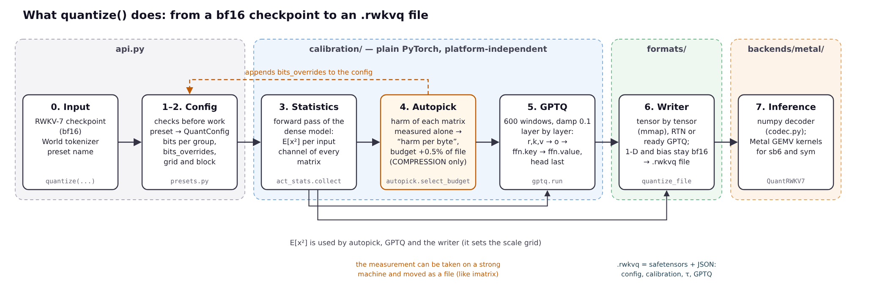
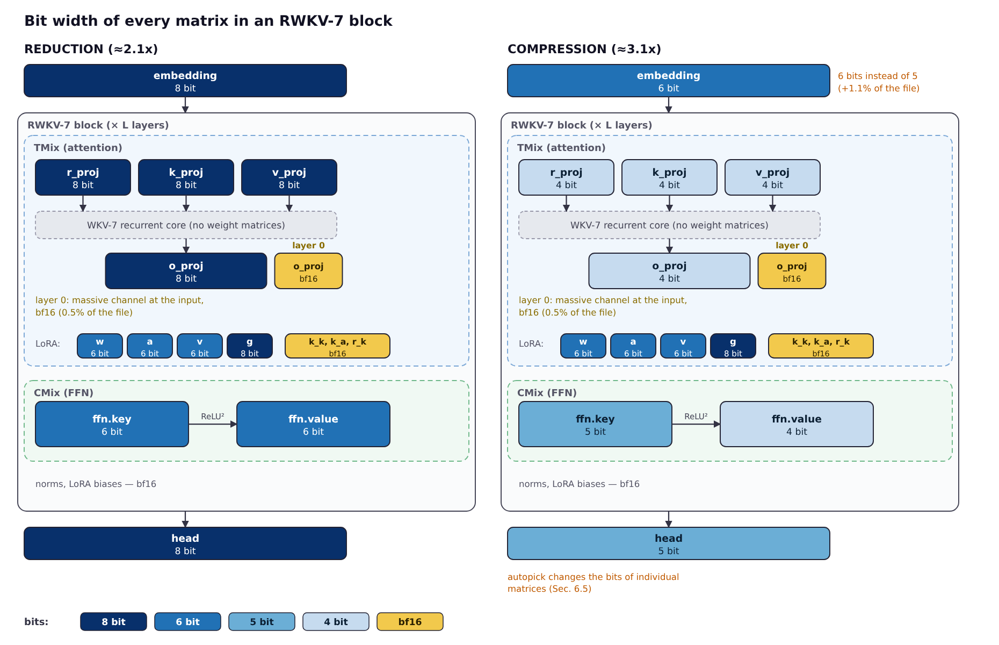
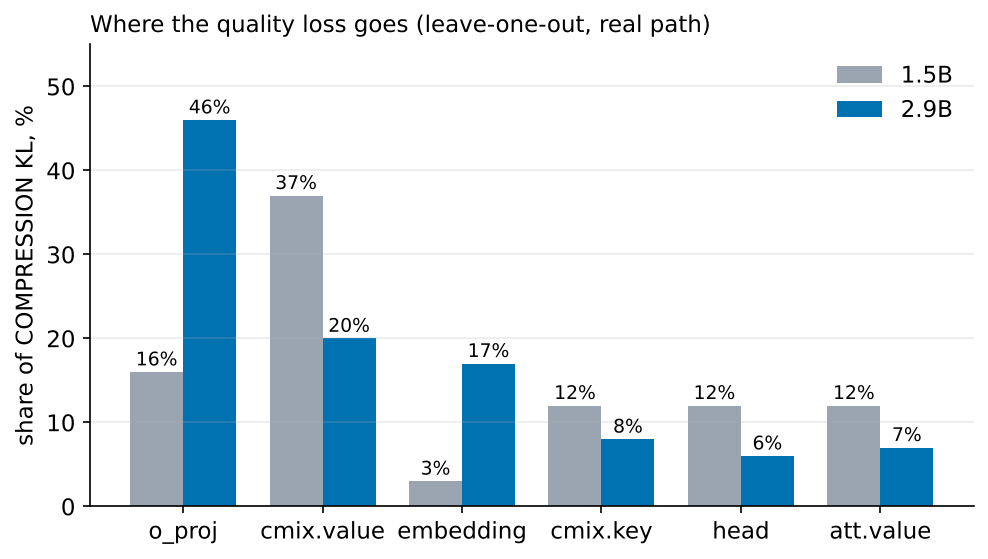
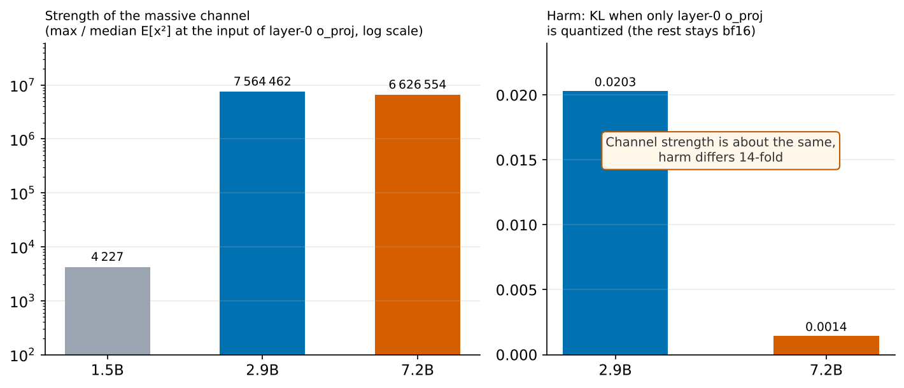
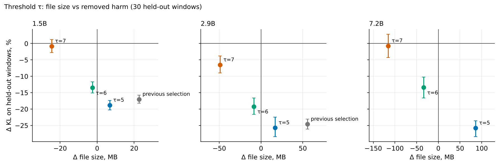
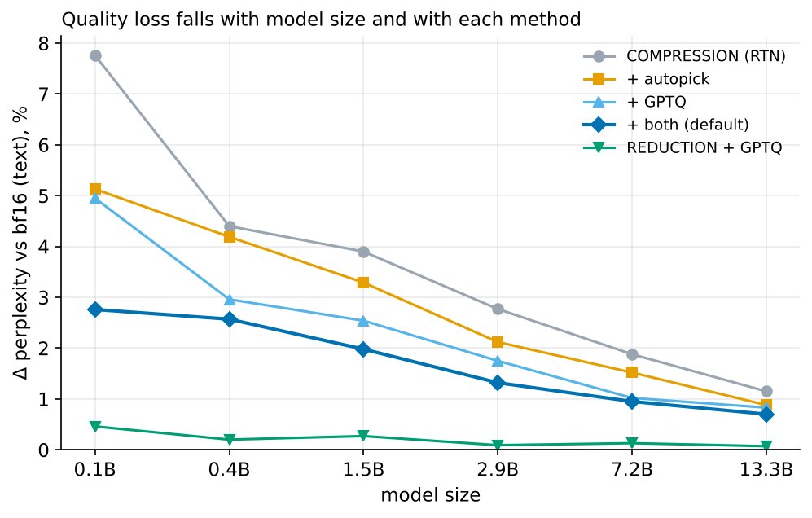
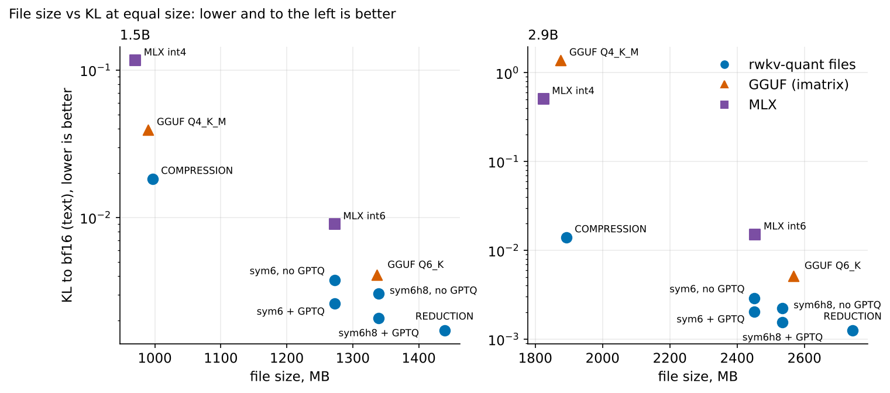

# Quantizing RWKV-7: What Breaks in Models of Different Sizes

**Alexei Goncharov**, independent researcher

---

## Abstract

I study post-training quantization of the RWKV-7 family (from 0.1B to 13.3B parameters) with two presets: REDUCTION (about 2.1x compression, nearly lossless) and COMPRESSION (about 3.1x, 4 bits on projections). The question that started this work: why does the 4-bit preset degrade the 2.9B model more than the 1.5B one (+4.04% versus +2.85% perplexity), when the opposite is expected?

It turned out that up to 86% of the contribution of the whole `o_proj` group on 2.9B comes from a single matrix: the output projection of block 0. Its input carries a "massive channel" (98% of the input energy sits in eight channels out of 2560). Keeping this one matrix in bf16 (0.5% of the file) reduces the KL divergence to the reference by 39% and puts 2.9B back into a monotonic size ladder; raising the embedding from 5 to 6 bits removes a further 22% of KL for 1.1% of the file. Three natural local error metrics do not predict the harm of quantizing a matrix; what does predict it is the error injected into the residual stream, multiplied by the amplification further down the depth. On this basis I build an automatic bit-width selection ("autopick") with the rule "harm removed per byte" (−16…−39% KL with the file growing by at most 0.5%) and carry GPTQ over to the same grid (−29…−43% KL at the same bytes).

Together the methods give a perplexity loss from +2.76% (0.1B) to +0.70% (13.3B) on a file of 31.6–35.2% of the bf16 size, decreasing monotonically with model size. The REDUCTION preset with GPTQ gives +0.46…+0.07% at 46–50% of bf16. At equal file size, the KL of my 6-bit file with GPTQ is 2.0–3.3 times lower than GGUF Q6_K with imatrix and 3.5–7.4 times lower than MLX int6; my 4-bit file is 2.1 times more accurate than Q4_K_M on 1.5B, while Q4_K_M breaks on 2.9B. Separately, I describe the leakage of the calibration corpus into my first evaluation set and the measured size of its effect, as well as the spread of GPTQ results between numerically equivalent implementations (about ±1.5% KL).

**Keywords:** RWKV-7, post-training quantization, GPTQ, massive activations, mixed precision, Apple Silicon.

---

## 1. Introduction

Models of the RWKV family, with their recurrent structure that is linear in sequence length, are attractive for local inference, but there are noticeably fewer quantization tools for them than for transformers. In this work I describe the `rwkv-quant` tool, which compresses RWKV-7 with two ready-made presets, and systematically examine where exactly quality is lost under quantization and how this depends on model size.

The work began with an observation that contradicts the usual intuition that "the larger the model, the smaller the relative loss". The COMPRESSION preset on 2.9B showed +4.04% perplexity against +2.85% on 1.5B. Finding the cause took most of the study and led to a set of results that I consider useful independently of the particular tool.

**Contributions.**

1. **Localizing the loss.** A leave-one-out decomposition of KL over matrix groups shows that on 2.9B the harm is concentrated in two places: the output projection of block 0 (`o_proj` of layer 0) and the embedding table. Keeping the first in bf16 costs 0.5% of the file and removes 39% of KL; raising the second from 5 to 6 bits costs 1.1% of the file and removes another 22% (Section 4).
2. **Mechanism and predictability.** The input of the problematic matrix carries a massive channel, but the energy concentration alone does not predict harm: it is strongest in 7.2B, and that model quantizes best of all. I show that three natural local error metrics do not work, and describe the metric that does: the error in the residual stream multiplied by the measured amplification (Section 5).
3. **Automatic bit-width selection** by the "harm per byte" rule, which works in both directions (one byte price for raising and lowering bits), measuring one matrix per pass (Section 6).
4. **GPTQ on the preset grid** without changing the format, the kernels or the file size; I show that regularization matters more than calibration size and that autopick and GPTQ combine almost multiplicatively (Section 7). GPTQ in the REDUCTION preset is described in Section 8.
5. **A summary over six sizes** from 0.1B to 13.3B with confidence intervals from a paired bootstrap over windows (Section 9), and a **comparison with GGUF and MLX** at equal file size (Section 10).
6. **Methodological findings.** Leakage of the calibration corpus into the evaluation set and its measured size (Section 3.4); the spread of GPTQ results between numerically equivalent implementations and its quantification (Section 7.6); four engineering errors that distorted the measurements (Appendix A).

---

## 2. Related Work

**Quantization with error correction.** GPTQ (Frantar et al., 2022) quantizes the columns of a matrix one at a time and spreads the error of each onto the not-yet-quantized columns through the inverse Hessian of the input activations. I carry GPTQ over to the asymmetric superblock grid (Section 7) and to the symmetric Q6_K-type grid (Section 8). The file format and the kernels do not change.

**Activation weighting.** AWQ and the importance matrix (imatrix) in llama.cpp use activation statistics to protect the more important channels. In my tool, the activation statistics (AW, *activation-weighted*) determine the choice of scale and offset for groups of weights; without them, 4 bits in `o_proj` destroy 2.9B (Section 4.3).

**Outliers and massive activations.** Dettmers et al. (2022, LLM.int8()) described feature outliers concentrated in a few channels of the hidden state and their role in the degradation of quantized transformers. Sun et al. (2024) described "massive activations": values orders of magnitude larger than the median in a few channels. The massive channel at the input of the `o_proj` of block 0 (Section 4.3) is a close relative of these phenomena, but, as I will show, its strength alone does not predict harm.

---

## 3. Setup and Methodology

### 3.1 Models

The study covers the RWKV-7 line in six sizes. Three pairs are used to isolate factors: 0.4B/1.5B (the same depth, twice the width), 2.9B/7.2B (the same depth L=32, width 2560 versus 4096) and 7.2B/13.3B (the same width, depth 32 versus 61).

| model | layers L | width D | heads H=D/64 | D/L | checkpoint series |
|---|---|---|---|---|---|
| 0.1B | 12 | 768 | 12 | 64 | g1d |
| 0.4B | 24 | 1024 | 16 | 42.7 | g1d |
| 1.5B | 24 | 2048 | 32 | 85.3 | g1d, g1h, g1j |
| 2.9B | 32 | 2560 | 40 | 80 | g1h, g1j |
| 7.2B | 32 | 4096 | 64 | 128 | g1j |
| 13.3B | 61 | 4096 | 64 | 67.2 | g1j |

The summary tables (Sections 9–10) refer to the g1j series; the diagnostics (Section 4) partly use g1d and g1h, as stated in the text.

### 3.2 Presets

The `rwkv-quant` tool compresses a model with two presets.

- **REDUCTION** (nearly lossless). Projections (`proj`) use 8 bits in the symmetric `sym_aw` layout with a group of 16 weights; `cmix` (channel mixing, the FFN) uses 6 bits; the embedding and the head use 8 bits; the LoRA branches `w`, `a`, `v` use 6 bits and `g` uses 8 bits (block 64). Compression is about 2.1x.
- **COMPRESSION** (aggressive). Projections use 4 bits in the asymmetric superblock layout `asym_sb6_aw` with a group of 32; `cmix` uses 4 bits, except `ffn.key`, which uses 5; the embedding uses 6 bits (5 in the early measurements, Section 4.5); the head uses 5 bits; the LoRA branches are the same as in REDUCTION. Compression is about 3.1x.

In the layouts with the `_aw` suffix, the scale and offset of each group are chosen by a search weighted by the mean square of the input activation of the channel, E[x²], that is, by statistics collected on the calibration corpus. The REDUCTION layout is symmetric (one scale per block of 16 weights, no offset; int8 scale codes against one fp16 multiplier per superblock of 16 blocks; 6 or 8 bits). The COMPRESSION layout (`sb6`) is an asymmetric superblock one: a block of 32 weights and a superblock of 8 blocks (256 columns); the scale and offset of each block are stored as 6-bit codes `qs` and `qm` relative to two fp16 multipliers of the superblock.

The small per-channel vectors (`k_k`, `k_a`, `r_k`), the norms and the biases of the LoRA branches are not quantized and are stored in bf16. The embedding table has no activation statistics (its input is token indices), so in both presets its grid is chosen without AW weighting; GPTQ does not touch the embedding either.

The two fixes found in Section 4 are part of the final COMPRESSION: the output projection of layer 0 (`o_proj` of layer 0) is stored in bf16, and the embedding in 6 bits. The preset without these fixes is called "base" in the text (`compression_nol0` in the logs).

*Fig. 1. The `quantize()` pipeline. The activation statistics E[x²] are used by autopick, GPTQ and the writer; the result of autopick is appended to the config (`bits_overrides`). Calibration does not depend on the platform; the format and the backend are separated from it.*

*Fig. 2. Bit widths of the matrices in the REDUCTION and COMPRESSION presets. The two fixes are highlighted: `o_proj` of layer 0 in bf16 and the embedding at 6 bits instead of 5 (Section 4). Autopick (Section 6) changes the bits of individual matrices on top of the COMPRESSION preset.*

### 3.3 Metrics and Instruments

The main metric is the per-token **KL(bf16‖quant)**: the divergence of the next-token distribution of the quantized model from that of the bf16 model. The reference logits are computed in fp32 and stored on disk (5.09 GB per model). The second metric is the relative change in perplexity (**Δppl**, in percent) with respect to the bf16 model. The reference is taken as a number (an estimate of the reference arm), not as a file size.

Two computation paths are used, and their absolute KL values differ, so comparisons are valid only within one instrument:

- the **fake path** (PyTorch): weights are quantized and immediately dequantized, and computation runs in dense tensors; it works on a Mac (MPS) and on a server (CUDA);
- the **real path** (MLX): the codes are packed into the `.rwkvq` format and read by Metal kernels; Mac only.

The instruments are listed in Appendix C.

### 3.4 Evaluation Sets and Leakage

The **first set**, `eval_corpus_multiling` (en/ru/sr, 38 windows of 512 tokens), was used in Sections 4–6 and turned out to lie entirely inside the package's calibration corpus: 100% of its 16-grams are shared. For a method calibrated on that corpus this is direct leakage.

The scale of the leakage was measured on GPTQ (Section 7) calibrated on the package corpus: on 1.5B the KL gain on text was −61.8% on the old set and −27.1% on the clean one, so the leakage overstated the gain 2.3 times. Code is clean (one window out of 24 contains shared 16-grams, 0.03%).

The AW statistics are affected partially: its 23 windows of 512 tokens contain 23.9% of the 16-grams of the old set and overlap with 13 of its 38 windows. The absolute numbers of Section 4 were obtained on text that AW had partly used to weight its search; the direction of the bias is in favor of AW, and its size was not measured. Comparisons inside the section (which matrix, which bit width) were made with the same statistics, so the bias enters both arms. Autopick did not benefit from the leakage: on 1.5B it gives −16.1% on the old set and −17.6% on the clean one.

**Clean sets** (not a single shared 16-gram with any calibration corpus):

- `eval_text_heldout`: Wikipedia en/ru/sr, 12 windows per language (36 windows);
- `eval_code_heldout`: 24 Python/Swift windows (a closed set);
- `eval_code_open`: 48 windows (24 Python, 24 Swift) from the author's open repositories.

The rule: any calibrated method is measured only on clean sets, and before a measurement it is checked that the overlap of 16-grams between the calibration and the set is zero. Sections 4–5 and the threshold table in Section 6.3 were measured on the old set (in the table of Section 6.3 the windows did not take part in the selection, but lie inside the calibration corpus); the autopick result is re-checked on clean sets in Section 6.4. Sections 7–10 use only clean sets.

### 3.5 Statistics

Confidence intervals are built by a **paired bootstrap over windows** (20,000 repetitions; windows are resampled jointly for both compared arms). When comparing with other formats, the same is done for KL ratios. For KL the half-width of the 95% interval is 7–12% of the value. In addition, to estimate the spread of GPTQ itself between implementations, replicas with a permuted order of calibration windows were used (Section 7.6).

---

## 4. Where Quality Is Lost

> **Note on the sets.** The measurements of Sections 4 and 5 were made on the first evaluation set (Section 3.4), which partly overlaps with the AW statistics. The absolute values may be slightly biased in favor of AW; comparisons between matrices and bit widths inside the section were made with the same statistics. All subsequent results (Sections 6.4–10) were obtained on clean sets with the fixes found here already in the preset.

The basic question: why does COMPRESSION degrade 2.9B more than 1.5B (+4.04% versus +2.85% ppl)?

### 4.1 Decomposition of the Loss over Matrix Groups

The contribution of a matrix group is determined by the leave-one-out method: contribution = KL(everything quantized) − KL(everything except this group). Results for the g1h series, real path (Mac, MLX):

| group | 1.5B: KL (share) | 1.5B: ppl, pp | 2.9B: KL (share) | 2.9B: ppl, pp |
|---|---|---|---|---|
| `o_proj` | 0.00578 (16%) | 0.64 | **0.02368 (46%)** | **1.82** |
| `cmix.value` | 0.01317 (37%) | 0.99 | 0.01035 (20%) | 0.63 |
| embedding | 0.00120 (3%) | 0.07 | **0.00874 (17%)** | 0.83 |
| `cmix.key` | 0.00442 (12%) | 0.43 | 0.00400 (8%) | 0.36 |
| head | 0.00440 (12%) | 0.39 | 0.00310 (6%) | 0.36 |
| `att.value` | 0.00443 (12%) | 0.37 | 0.00378 (7%) | 0.52 |
| `r`, `k`, LoRA | ≤4% | ≤0.08 | ≤2% | ≤0.12 |

The contributions sum to 101% and 107%, so the groups are almost additive. On 2.9B two groups stand out: `o_proj` (46% of the total KL) and the embedding (17%); on 1.5B their contribution is modest (16% and 3%) and the main contribution comes from `cmix.value`.

The same analysis on the server (fake path, g1j series, base preset `compression_nol0`) confirms the picture:

| model | base KL | `o_proj` of layer 0 | whole `o_proj` | embedding | `cmix.value` | head |
|---|---|---|---|---|---|---|
| 1.5B | 0.050962 | 0.5% | 13% | 2.8% | 29% | 8.3% |
| 2.9B | 0.077513 | **39%** | 45% | **30%** | — | — |
| 7.2B | 0.022984 | 3.9% | 13% | 8.4% | 25% | 9.4% |

*Fig. 3. Shares of the KL loss by matrix group (leave-one-out, real path, g1h series), 1.5B and 2.9B. Data of the first table of the section.*

### 4.2 The Main Finding: `o_proj` of Layer 0

On 2.9B, 85–86% of the contribution of the whole `o_proj` group comes from a single matrix: the output projection of block 0. A direct experiment (real path, 2.9B, g1h) compares the base preset with variants in which individual parts of `o_proj` are stored at higher precision:

| arm | KL | ppl | en / ru / sr | file growth |
|---|---|---|---|---|
| base | 0.052048 | +4.04% | +4.24 / +3.21 / +5.71 | — |
| **`o_proj` of layer 0 in bf16** | **0.031966** | **+2.43%** | +3.02 / +2.19 / +2.36 | +9.4 MB (+0.5%) |
| `o_proj` of layer 31 in bf16 | 0.051512 | +4.07% | ≈ base | +9.4 MB |
| whole `o_proj` at 5 bits | 0.046043 | +3.54% | ru worse: 3.21→3.44 | +26.2 MB |
| whole `o_proj` at 6 bits | 0.036305 | +2.89% | — | +52.4 MB |

A single 2560×2560 matrix in bf16 recovers 85% of the contribution of the `o_proj` group for 0.5% of the file, and works better than moving the *whole* `o_proj` to 6 bits for 2.8% of the file. The control arm (layer 31) gives no effect, so it is specifically layer 0 that matters. After the fix 2.9B becomes better than 1.5B: +2.43% versus +2.85%.

The same fix at other scales (real path):

| preset | model | KL: base → with fix | ppl | file growth |
|---|---|---|---|---|
| COMPRESSION | 0.1B | 0.08960 → 0.08279 (−7.6%) | +8.68% → +8.01% | +0.8 MB |
| COMPRESSION | 0.4B | 0.04965 → 0.04891 (−1.5%) | +4.31% → +4.28% | +1.5 MB |
| COMPRESSION | 1.5B | 0.03599 → 0.03585 (−0.4%) | +2.85% → +2.87% | +6.0 MB |
| COMPRESSION | 2.9B | 0.05205 → 0.03197 (−39%) | +4.04% → +2.43% | +9.4 MB |
| REDUCTION | 0.4B / 1.5B | unchanged | — | +1.0 / +3.9 MB |
| REDUCTION | 2.9B | 0.001635 → 0.001573 (−3.8%) | +0.08% → +0.06% | +6.1 MB |

Only the effects on 0.1B and 2.9B are significant: on 0.4B and 1.5B the change in cross-entropy is not distinguishable from zero. The fix matters only in COMPRESSION on 2.9B and, to a lesser extent, on 0.1B.

### 4.3 Mechanism: the Massive Channel at the Input of `o_proj` of Layer 0

The input of the `o_proj` of layer 0 carries a "massive channel": one or two channels that are several orders of magnitude stronger than the rest in the mean square activation E[x²].

| model | max/median E[x²] | share of energy in 8 channels | channel index |
|---|---|---|---|
| 0.1B g1d | 2 628 | 0.77 | 112 |
| 0.4B g1d | 22 580 | 0.91 | 53 |
| 1.5B g1d | 2 245 | 0.46 | 1202 |
| 1.5B g1h | 3 740 | 0.53 | 1202 |
| 1.5B g1j | 4 227 | 0.54 | 1202 |
| 2.9B g1h | 7 199 995 | 0.98 | 517 |
| 2.9B g1j | 7 564 462 | 0.98 | 517 |
| 7.2B g1j | 6 626 554 | 0.99 | 160 |

The channel index is **the same for all series of one width**: 1202 for the three 1.5B series and 517 for the two 2.9B series. It is therefore a property of the width and the architecture, not of a particular training run.

How much the AW statistics hold this matrix together is visible from the "`o4s`" arm: the same 4 bits, but the search is done without AW, in `o_proj` only.

| model | KL: base → without AW | ppl |
|---|---|---|
| 1.5B | 0.035992 → 0.042974 | +2.85% → +3.57% |
| 2.9B | 0.052048 → **0.340025** | +4.04% → **+37.2%** |

On 2.9B, AW holds almost everything: without it, 4 bits in `o_proj` destroy the model.

### 4.4 Why Exactly 2.9B and Not "All Large Models"

The expectation "a larger model degrades less" is broadly true: on 2.9B all the ordinary groups (`r`, `k`, `v`, `cmix`, head, LoRA) lose less than on 1.5B, even in absolute numbers. Only `o_proj` and the embedding stand out.

However, on 7.2B the massive channel is the strongest of all (99% of the energy in eight channels), yet this model quantizes best of all: base KL 0.023 against 0.078 for 2.9B and 0.051 for 1.5B (one series, g1j, one instrument), and the layer-0 fix gives only −3.9% there. So the strength of the massive channel by itself does not explain the harm.

A direct measurement of the harm from quantizing a single matrix (*only* the `o_proj` of layer 0 is quantized, the rest stays in bf16) on 2.9B and 7.2B:

| | KL | ‖Δx‖/‖x‖ at layer 0 | peak over depth |
|---|---|---|---|
| 2.9B | 0.020290 | 13% | 31% (layers 13–16) |
| 7.2B | 0.001427 | 3.4% | 6.7% (layer 13) |

The 14-fold difference in KL arises **at the moment the error is injected into the residual stream**, not in its propagation: the amplification down the depth is similar for both models (2.4x and 2.0x by the middle of the network). This leads to the question of what predicts harm at all (Section 5).

*Fig. 4. Strength of the massive channel (max/median E[x²]; g1j series) and the harm from quantizing only the `o_proj` of layer 0 on 2.9B and 7.2B. The channel strength is almost the same, while the harm differs 14-fold.*

### 4.5 The Second Address: the Embedding

On 2.9B the embedding accounts for 17% of KL (g1h series) and 30% (g1j); on 1.5B, 3%. Raising the embedding from 5 bits to 6 (real path, on top of the preset with the layer-0 fix):

| model | KL | ppl | en / ru / sr | file growth |
|---|---|---|---|---|
| 2.9B, base | 0.031966 | +2.43% | +3.02 / +2.19 / +2.36 | — |
| **2.9B, embedding at 6 bits** | **0.024885 (−22%)** | **+1.86%** | +2.33 / +1.66 / +1.82 | +21.0 MB (+1.13%) |
| 2.9B, embedding in bf16 | 0.024539 (−23%) | +1.82% | — | +220 MB |
| 1.5B, embedding at 6 bits | 0.034933 (−2.6%) | +2.82% | noise | +16.8 MB |

6 bits capture 95% of what full bf16 gives, at a tenth of the cost. Eight bits are not available for the embedding: the superblock layout knows only 4, 5 and 6 bits. Both fixes together take 2.9B from +4.04% to +1.86% at a cost of about 1.6% of the file.

**Decision: the embedding at 6 bits is always part of COMPRESSION.** Recomputation from the written files (real path, 38 windows; the previous file is measured with the same instrument alongside):

| model | ppl: before → after | KL: before → after | ΔCE, 95% CI | file growth |
|---|---|---|---|---|
| 0.1B | +8.00% → +7.50% | 0.0828 → 0.0780 | significant | +6.3 MB (+4.9%) |
| 0.4B | +4.28% → +4.20% | 0.0489 → 0.0468 | within noise | +8.4 MB (+2.9%) |
| 1.5B | +2.87% → +2.82% | 0.0359 → 0.0349 | within noise | +16.8 MB (+1.7%) |
| 2.9B | +2.43% → +1.85% | 0.0320 → 0.0249 | significant | +21.0 MB (+1.1%) |

The cost of the fix is only file bytes: in COMPRESSION the embedding is expanded into dense fp16 (gather applies only to the symmetric layout), and one row of the table is read per token.

### 4.6 Speed

The decode speed of 2.9B was measured on two files built by the same code and differing only in layer 0 (bf16 versus a quantized matrix), with ABBA alternation in one process:

| load order | difference |
|---|---|
| file without the fix first | −0.40 ms/token (−1.6%) |
| file with the fix first | −0.52 ms/token (−2.2%) |
| A/A control | −0.02 [−0.13; +0.10] |

The file with the bf16 matrix is not slower but **faster**, even though it reads 9.4 MB more. The mechanism is not established: a single matrix should not account for half a millisecond, and I do not claim an explanation. The practical conclusion is that the layer-0 fix does not cost speed.

---

## 5. What Predicts the Harm of Quantizing a Matrix

Section 4 shows that the harm of quantization is very uneven between matrices and that a single matrix with a "massive" input can matter more than a whole group. The question is whether such matrices can be predicted in advance, without quantizing each one separately. I tested three natural features and rejected all three.

**Feature 1: concentration of input energy.** The share of energy in eight channels does not predict harm: 0.99 for 7.2B (practically no harm), 0.77 for 0.1B (harm present), 0.91 for 0.4B (no harm).

**Feature 2: diagonal output error of the layer**

$$\frac{\sum_c E[x_c^2]\,\lVert \Delta W_c\rVert^2}{\sum_c E[x_c^2]\,\lVert W_c\rVert^2}.$$

For layer 0 it is the **smallest** in all five models checked. The reason is clear: the AW search minimizes exactly this quantity, so the feature measures the quality of the search, not the harm.

**Feature 3: the honest local injection error** ‖(W−Ŵ)X‖/‖WX‖ on real activations. On 2.9B the maximum is at `ffn.value` of layers 15–19 (0.16), while the `o_proj` of layer 0 is not even in the top dozen. Control: quantizing *only* `blocks.15.ffn.value` gives KL 0.000776 against 0.020290 for the `o_proj` of layer 0, that is, 26 times less harm at a local error four times larger.

**Conclusion.** The local error is normalized by the wrong thing. What matters is the error injected *into the residual stream*, multiplied by how strongly the subsequent layers amplify it. The trace of the error of layer 15 decays with depth (4.9% → 2.2%), while the trace of layer 0 grows (13% → 31%).

**The feature that works.** The error of a sublayer in the residual stream ‖Δx‖²/‖x‖², multiplied by the amplification G of that point, where G is measured directly: by injecting noise ε = 1% at the same point and measuring KL at the output. The rank correlation with the true single-matrix harm (KL when only this matrix is quantized) is 0.977 (0.1B), 0.969 (1.5B), 0.920 (2.9B); the top three matrices on 2.9B coincide. Weaknesses of the feature: the contribution of the embedding through the point x₀ is overestimated (isotropic noise does not resemble the real error), and the internal matrices of layer 0 are underestimated (`v_first` is not modeled).

For the practical rule this feature turned out to be unnecessary. The rule pays per *byte* (Section 6), and for it the most honest tool is a direct measurement of the single-matrix harm of each matrix: one pass per matrix, which is comparable in cost to measuring the amplification G (2L+1 passes).

---

## 6. Autopick: the "Harm per Byte" Rule

A fixed list of fixes ("`o_proj` of layer 0 in bf16, embedding at 6 bits") is bad because the problematic matrices differ between models. Below is a rule for choosing bit widths from measurements that works in both directions.

### 6.1 The Rule

For a matrix m and a step of its bit width b → b′ define

$$e = \frac{\text{share of KL that the step removes or adds}}{\text{share of file bytes that it costs}},$$

where KL is taken for a model in which **only this** matrix is quantized, against the fp32 reference. A step up is taken if e ≥ τ; a step down if e < τ. A single threshold τ on both sides means a single price of a byte: bits move to where they pay off most.

The byte cost of a matrix is computed as params·(b + 0.5)/8 (0.5 bit per weight for the `sb6` scales) and 2·params for bf16. The ladder of levels is 4, 5, 6 bits and bf16. A step down is allowed only to 4 bits (the format has no 3-bit layout); the embedding never goes down. Raises are chosen greedily in decreasing e while e ≥ τ. For a given file budget (+0.5% by default) the smallest τ is taken at which the byte growth fits the budget; it is found by bisection on log τ. If the budget is unreachable even at the largest τ, the selection at that τ is returned together with an "unreachable" flag.

The objective of the selection is the mean KL over 14 windows of the calibration corpus taken by the language quota en 4 / code 4 / ru 2 / sr 2 / zh 2 (the language weights are proportional to the number of windows; the weights can be set explicitly if needed).

### 6.2 Candidates and Lowering

**The first version erred in the choice of candidates, not in the feature.** Initially the 12 top matrices by absolute harm plus the end layers were examined. But the rule pays per byte, and small C×C matrices (`att.output` and `att.value` of the middle and late layers) are four times cheaper than `cmix` at moderate harm. A strict bound settles the question without assumptions: a step up cannot remove more than the single-matrix harm S of the matrix, hence

$$e \le \frac{S/\mathrm{KL}}{\text{bytes}\,+1\text{ bit per file}}.$$

According to the single-harm sweep, outside the 12 candidates there turned out to be 47 (1.5B), 61 (2.9B) and 59 (7.2B) matrices with a bound ≥ 5. The full selection at τ = 5 has 33 / 46 / 45 keys instead of 12.

**Three bits down are not needed.** The ladder down (KL of a single matrix one bit lower) showed that 3-bit steps at e < 5 give no more than 0.9% of the file (7.2B), usually 0.2–0.6%. The cheap bytes lie elsewhere: `ffn.key` 5 → 4 in the middle layers (e = 1.9–3.5), and the 4-bit layout already exists in the format. No new layout is needed.

### 6.3 Choosing the Threshold τ

The symmetric rule turns out to be byte-neutral at τ ≈ 5–6: the size of the preset was right, it was the distribution of bits that was wrong. Below is the KL of the file on 30 windows that did not take part in the selection (but lie inside the calibration corpus, Section 3.4), paired with the preset by window; speed is ABBA alternation in one process on a Mac.

| | Δ size | ΔKL, held-out windows | windows worse | Δ decode |
|---|---|---|---|---|
| 1.5B, previous selection (12 keys, up only) | +22.6 MB | −17.0% [−18.2; −15.8] | 0/30 | +1.7% |
| 1.5B, sym τ=5 | +6.8 MB | −18.8% [−20.3; −17.4] | 0/30 | within noise |
| 1.5B, sym τ=6 | −2.6 MB | −13.5% [−15.1; −11.7] | 1/30 | −0.5% |
| 1.5B, sym τ=7 | −24.6 MB | −0.8% [−2.8; +1.2] | 13/30 | −2.0% |
| 2.9B, previous selection | +55.4 MB | −24.6% [−26.1; −23.1] | 0/30 | +2.4% |
| 2.9B, sym τ=5 | +16.9 MB | −25.7% [−28.4; −22.5] | 0/30 | within noise |
| 2.9B, sym τ=6 | −8.5 MB | −19.2% [−21.6; −16.6] | 0/30 | within noise |
| 2.9B, sym τ=7 | −49.2 MB | −6.5% [−9.0; −3.8] | 6/30 | −2.4% |
| 7.2B, sym τ=5 | +86.0 MB | −25.8% [−28.4; −23.6] | 0/30 | not measured |
| 7.2B, sym τ=6 | −33.6 MB | −13.4% [−16.6; −10.2] | 0/30 | not measured |
| 7.2B, sym τ=7 | −115.3 MB | −0.7% [−4.3; +2.8] | 12/30 | not measured |

τ = 5 gives the quality of the previous selection for a third of the bytes and without losing speed; τ = 7 gives the quality of the preset on a file 2.5% smaller and 2% faster. Speed here does not follow from bytes: the previous selection added 22.6 MB and slowed decoding by 1.7%, while sym τ=5 adds 6.8 MB and does not slow it, because the bytes moved from matrices read at every token to others.

**A caveat that the data produced by itself.** In this prototype the selection was made on 8 windows (3 ru / 3 en / 2 sr), and English gains the least (7.2B, τ=6: en −7.7% against sr −19.4%; at τ=7 English is even 4.6% worse than the preset). What the rule minimizes is a decision about the target data, not an implementation detail.

*Fig. 5. Choice of the threshold τ: change of file size and of KL on 30 held-out windows (paired with the preset, 95% CI). Data of the table above.*

### 6.4 Clean Evaluation on Models from 1.5B to 13.3B

Instrument: the fake path on the server, 36 windows of clean text and 24 windows of clean code, KL to bf16 with the same instrument (for 1.5B, a measurement on the Mac). Budget +0.5% of the file. Change relative to the preset without autopick:

| model | KL text | en | ru | sr | KL code | Δppl text | Δppl code |
|---|---|---|---|---|---|---|---|
| 1.5B (Mac) | −17.6% | −17.9 | −16.9 | −18.0 | −13.5% | +3.88 → +3.25% | +3.86 → +3.32% |
| 7.2B | −20.7% | −25.1 | −16.1 | −20.3 | −13.6% | +1.85 → +1.51% | +1.22 → +0.86% |
| 13.3B | −21.1% | −23.4 | −17.0 | −22.5 | −17.4% | +1.14 → +0.86% | +1.11 → +0.58% |

The gain does not fall as the model grows. The prediction made by the measurement itself on 13.3B is overestimated 1.5 times: −32.9% was predicted, −21.1% measured (on 1.5B the prediction was close). Therefore, as above, only the measurement of the written file counts as a result.

The full table with the paired bootstrap for the six models is given in Appendix B.1. Its summary: by KL, autopick is significantly better than the preset on every model and in every slice; by ppl the gain is not significant in two cells (text on 0.4B and code on 2.9B). The weak spot is English on 0.4B: KL −7.5%, three windows out of twelve worse than the preset, ppl +0.46% [−0.25; +1.14].

### 6.5 What Autopick Chooses

The number of matrices whose bit width is raised or lowered (budget +0.5% of the file):

| model | up | down | what goes down |
|---|---|---|---|
| 0.1B | 47 | 1 | — |
| 0.4B | 52 | 10 | — |
| 1.5B | 46 | 16 | — |
| 2.9B | 59 | 25 | `ffn.key` 5 → 4 bits |
| 13.3B | 110 | 37 | — |

Mostly `o_proj` and `v_proj` (5 bits) and `ffn.value` go up. The +0.5% budget is not used in full: the rule is limited by τ, and the file growth is 0.1–0.2% (on 0.4B the size even decreases).

### 6.6 Measurement Without Ladders and Its Cost

Levels above the preset's bit width need not be measured: the KL of a single matrix falls with each bit almost identically for all matrix types and scales. The ratio r = KL(b+1)/KL(b) is 0.315 (`proj`), 0.313 (`cmix.value`), 0.317 (`cmix.key`) and 0.41 (head), medians over 500+ steps on six models from 0.1B to 13.3B. Selection by the formula "measured base × rᵏ" gives the same efficiency (percent of KL removed per megabyte) as selection by the true ladders at all scales checked. The predicted gain is overestimated, however (1.5B, τ=6: −19% predicted, −13% measured), so the rule's own report serves only as a guide.

The cost of the measurement is one pass per matrix at the preset bit width and one per realizable step down. A pass resumes from the clean residual stream at the input of the matrix's layer: the layers before it are not changed by quantization, the result is bit-identical to that of a full pass (verified by a gate), and on average half as much work is done. The instrument is an fp32 model with weights stored in bf16: the upcast is exact, so it is the same fp32 model at half the memory; the reference is computed by the same instrument in the same process, and the KL floor is zero by construction.

### 6.7 What the Rule Does Not Do

The rule does not protect against the absence of AW statistics (Section 4.3: without them 2.9B is destroyed) and does not cancel the fixed fixes of the preset: the `o_proj` of layer 0 and the embedding at 6 bits remain its starting point. On large models the measurement is computed wherever memory suffices and is transferred as a file with a strict checkpoint signature, in the same way as imatrix for GGUF.

---

## 7. GPTQ on the COMPRESSION Preset Grid

> **Note.** The tables of Sections 7.2–7.5 and Appendix B were obtained with the server prototype of GPTQ. The final numbers for the files that the library writes are given in Section 9; the point values of the prototype and of the library differ within the spread between implementations (Section 7.6). All measurements of this section are on clean sets (Section 3.4).

### 7.1 Method

I carry GPTQ (Frantar et al., 2022) over to the asymmetric superblock grid `asym_sb6_aw`:

- the scale and offset of a superblock (256 columns) are computed at its start, from the already corrected weights, with the same AW search that is used in ordinary writing (RTN);
- the columns are quantized one at a time;
- the error of each column is spread onto the not-yet-quantized ones through H⁻¹.

The pass is sequential: the input of each matrix is taken from a model in which the previous matrices are already quantized (order: `r`, `k`, `v` → `o` → `ffn.key` → `ffn.value`, head last). The embedding is a lookup table, and GPTQ does not touch it. The file format, the kernels and the size do not change.

Correctness checks: with a diagonal H the codes are bit-identical to RTN (check 0); the file written by the library is bit-identical to the fake path of GPTQ (gate).

### 7.2 Regularization Matters More than Calibration Size

First version: 48 windows of the package corpus, damping damp = 0.01. KL relative to RTN, clean set:

| model | text | en | code |
|---|---|---|---|
| 2.9B | −21.1% | −12.2 | −37.9% |
| 7.2B | **+0.4%** | **+13.6** | −21.4% |
| 13.3B | **+4.7%** | **+17.7** | −21.4% |

On the larger models English text became **worse** than RTN. The cause is overfitting: 24.5 thousand tokens to estimate an H of size up to 16384×16384. Two control runs on 7.2B confirm this: damp 0.1 on the same 48 windows gives −21.0% (en −17.1), while 82 windows at damp 0.01 give only −4.9% (en +6.7). It is the regularization, not the number of windows, that matters.

### 7.3 Calibration Corpus v2

600 windows of 512 tokens (307 thousand tokens), assembled from open sources:

| share | composition |
|---|---|
| en 30% | FineWeb-Edu |
| ru 20% | FineWeb-2, Russian literature, oasst2 |
| code 20% | UltraData-Code, 6 languages, plus the project's open code |
| zh 10% | FineWeb-2, novel_text |
| sr 10% | Cyrillic and Latin in equal parts |
| reasoning 10% | distillations of two models |

The order of windows is a weighted round-robin between groups, so any prefix preserves the shares. Windows containing 16-grams of any evaluation set were discarded.

### 7.4 Results: GPTQ versus RTN

KL relative to the RTN preset at damp 0.1 on clean sets (text / en / ru / sr / code) and the change in Δppl:

| model | windows | KL | Δppl text | Δppl code |
|---|---|---|---|---|
| 0.1B | 150 | −33.6 / −34.7 / −30.6 / −35.8 / −35.8 | +7.80 → +5.12% | — |
| 1.5B | 150 | −39.6 / −41.3 / −39.8 / −37.7 / −46.7 | +3.91 → +2.63% | +3.84 → +2.18% |
| 1.5B | 600 | −42.2 / −40.2 / −42.5 / −43.9 / −49.9 | +3.91 → +2.55% | +3.84 → +1.85% |
| 2.9B | 150 | −38.7 / −37.5 / −38.4 / −40.1 / −43.1 | +2.78 → +1.69% | +2.33 → +1.53% |
| 2.9B | 600 | −42.5 / −42.2 / −42.6 / −42.7 / −46.4 | +2.78 → +1.49% | +2.33 → +1.04% |
| 7.2B | 150 | −22.8 / −18.6 / −22.4 / −27.5 / −34.2 | +1.85 → +1.44% | +1.22 → +0.84% |
| 7.2B | 600 | −28.8 / −25.4 / −27.2 / −33.8 / −38.5 | +1.85 → +1.31% | +1.22 → +0.76% |
| 13.3B | 150 | −21.0 / −17.3 / −19.9 / −26.4 / −37.3 | +1.14 → +1.13% | +1.11 → +0.45% |
| 13.3B | 600 | −28.8 / −26.4 / −27.8 / −32.6 / −38.5 | +1.14 → +0.86% | +1.11 → +0.69% |

No language on any model is worse than RTN. damp 0.1 turned out better than 0.01 on the small models too: on 1.5B and 2.9B with 150 windows the difference is 5–7 pp. Larger models need more windows: going from 150 to 600 gives +6–8 pp on text for 7.2B and 13.3B and +3–4 pp on 1.5B and 2.9B. English gains less than the other languages at all scales.

A paired bootstrap over windows (600 calibration windows; Appendix B.2) shows that GPTQ is significantly better than RTN in KL and in ppl on every model, on text and on code; one window out of 360 was worse than RTN in KL (7.2B, text).

### 7.5 Together with Autopick

KL is measured relative to the preset without either method, 600 calibration windows. "Product" is the expectation under independence of the methods: (1 − GPTQ gain) × (1 − autopick gain).

| model | KL text | product | KL code | Δppl text | Δppl code |
|---|---|---|---|---|---|
| 0.1B | −62.3% | −59.8% | −63.1% | +7.80 → +2.84% | +6.83 → +2.68% |
| 0.4B | −45.6% | −47.9% | −42.8% | +4.43 → +2.72% | +4.74 → +2.22% |
| 1.5B | −52.0% | −52.3% | −55.1% | +3.91 → +2.11% | +3.84 → +1.49% |
| 2.9B | **−45.2%** | **−53.4%** | −51.4% | +2.78 → +1.28% | +2.33 → +1.04% |
| 7.2B | −42.5% | −43.5% | −44.9% | +1.85 → +1.07% | +1.22 → +0.46% |
| 13.3B | −41.3% | −43.9% | −47.6% | +1.14 → +0.58% | +1.10 → +0.27% |

On five models out of six the methods combine almost multiplicatively, within 3 pp. The exception is 2.9B: on top of GPTQ, autopick adds only −4.7% on text (−9.2% on code) instead of the expected roughly −19%. The first hypothesis (on 2.9B autopick spends bytes on the `o_proj` of layer 0, and GPTQ already repairs that matrix) turned out to be wrong: the `o_proj` of layer 0 is stored in bf16 in both presets and autopick does not touch it. An explanation by bit lowerings alone is also unconvincing: the share of lowerings on 2.9B is the largest, but on 13.3B it is only slightly smaller, and the combination there is almost multiplicative. It was then found that the anomaly is an artifact of a pair of prototype runs (Section 7.6): on the library's files, autopick on top of GPTQ on 2.9B gives −11.5% [−14.7; −8.2] and is significant.

An important detail: the autopick measurement is made with RTN. A direct check of the dependence would be to take the measurement on a model in which the remaining matrices have already gone through GPTQ and to compare the selection; it has not been carried out (Section 11).

### 7.6 Reproducibility and Spread of GPTQ

**Determinism.** The library's GPTQ is deterministic: two runs on different cards and a file built by `quantize()` under server load matched bit for bit (0.4B and 1.5B, REDUCTION, 144 tensors out of 144).

**Spread between implementations.** Two numerically equivalent implementations give different codes. The prototype took the upper Cholesky factor, the library the lower one with a transpose; the difference is of the order of 1e-15, but GPTQ spreads it over the whole matrix. The result for the library's file against the prototype, with the same instrument:

| | ΔKL, text / code | Δppl code |
|---|---|---|
| 1.5B COMPRESSION | +1.1 / +4.2% | +1.83 versus +1.49% |
| 2.9B COMPRESSION | −5.3 / +0.6% | — |
| 0.4B COMPRESSION | +0.2 / +0.1% | — |

The sign is random. So every single GPTQ number carries an "implementation" error of about ±5% KL and up to ±0.35 pp of ppl. Comparisons within this spread are not established.

**Replicas.** To measure the spread rather than estimate it from three pairs, the library's GPTQ was repeated with a permuted order of the 600 calibration windows: the windows are the same, only the order of summation of H changes, a perturbation of the same kind as changing the Cholesky factor. The files are written by `quantize()`, and the evaluation is the same instrument on the written file; code here is the open set (48 windows). Default COMPRESSION: 0.4B — 6 replicas, 1.5B and 2.9B — 4 each; "GPTQ only" on 2.9B — 4 replicas.

| model, arm | KL text: sd / range | KL code: sd / range | range of Δppl text / code, pp |
|---|---|---|---|
| 0.4B, default | 0.6% / 1.6% | 0.8% / 2.2% | 0.38 / 0.37 |
| 1.5B, default | 1.3% / 2.8% | 1.4% / 2.9% | 0.19 / 0.15 |
| 2.9B, default | 1.2% / 2.7% | 2.1% / 4.7% | 0.27 / 0.19 |
| 2.9B, GPTQ only | 0.6% / 1.5% | 1.3% / 2.9% | 0.28 / 0.13 |

What follows from this.

1. **The error of a single GPTQ number within the library is about ±1.5% KL (one sd), with a range up to 3–5%.** This is smaller than the earlier estimate of ±5%, which compared the library with the prototype. The original window order does not stand out from the cloud of replicas (deviation from the mean over permutations within ±2%).
2. **In ppl the spread of replicas is comparable to the interval over windows**: a range of 0.15–0.4 pp at Δppl +1…+2.7%. Differences in Δppl between arms smaller than 0.3 pp are not established for a single file.
3. **The noise of a single window is 4–8% KL** (median sd over replicas). Therefore a count of "in how many windows it is worse" is unreliable at effects of the order of 10%, while the mean over windows is stable.
4. **Autopick on top of GPTQ on 2.9B is significant.** Mean over replicas, interval from a joint bootstrap over windows and replicas: text −11.5% [−14.7; −8.2], code −7.4% [−10.6; −3.8]; all 16 pairs of replicas show a gain (text from −12.8 to −9.2%). On 0.4B and 1.5B (one "GPTQ only" replica) the gain on text is −12…−13% and −12…−14%.
5. **The methods combine slightly worse than the product, most strongly on 2.9B**: the ratio of the measured value to the product is 2.9B text 1.09 [1.05; 1.13], code 1.11 [1.07; 1.16]; 0.4B 1.03–1.05; 1.5B 1.04–1.07 on text and about 1.0 on code. The earlier 1.18 on 2.9B came from two deviations of the prototype in opposite directions: "GPTQ only" is 0.01560 for the prototype against 0.01601 for the library (mean of replicas), the default is 0.01486 against 0.01417.

### 7.7 Cost

GPTQ time on an RTX 4090 with 600 windows:

| model | cards | time |
|---|---|---|
| 1.5B | 1 | 42 min |
| 2.9B | 1 | 81 min |
| 7.2B | 2 | 2.6 h |
| 13.3B | 4 | 4.7 h |

The calibration activations are held on the host (2 × windows × 511 × D × 4 bytes), and the layers are distributed across the cards.

On a MacBook Air M4 with 16 GB and no fan, REDUCTION preset, a whole `quantize()` call:

| model | time | peak memory | swap (change over the run) |
|---|---|---|---|
| 0.1B | 17 min | 7.7 GB | +0 |
| 0.4B | 49 min | 8.9 GB | +0 |
| 1.5B | 2 h 26 min | 19.5 GB | −1.4 GB |

On 1.5B the peak exceeds the RAM size: macOS compresses memory, and the time per layer stays even (about 6 min). The estimate "model + activations", by which the library decides whether to run GPTQ implicitly, underestimates the peak by a factor of 2.4–3.4. Files built on the Mac (the GPTQ loop on CPU) match the server ones on the real path within the spread between implementations (1.5B, Δppl on two sets: +0.20 / +0.06% against +0.27 / +0.04%).

---

## 8. GPTQ in the REDUCTION Preset

REDUCTION stores projections, `cmix` and the head in the symmetric Q6_K-type layout (Section 3.2). GPTQ is carried over to this grid in the same way as to the asymmetric one: the superblock grid is built at its start from the corrected weights, and then the same loop follows. Check 0 with a diagonal H is bit equality with RTN at 6 and 8 bits. Calibration is the same 600 windows, damp 0.1.

KL relative to RTN-REDUCTION on clean sets (text / en / ru / sr / code) and Δppl. Times are on a single RTX 4090 while the cards were shared with other runs, so they are approximate:

| model | KL | Δppl text | Δppl code | time |
|---|---|---|---|---|
| 0.1B | −22.4 / −28.7 / −19.5 / −20.6 / −27.9 | +0.50 → +0.47% | +0.60 → +0.48% | 14 min |
| 0.4B | −22.7 / −21.5 / −22.7 / −23.7 / −27.2 | +0.29 → +0.21% | +0.23 → +0.18% | 29 min |
| 1.5B | −28.4 / −24.5 / −29.1 / −31.4 / −32.1 | +0.35 → +0.27% | +0.07 → +0.05% | 43 min |
| 2.9B | −29.6 / −26.2 / −31.2 / −31.4 / −33.6 | +0.15 → +0.09% | +0.15 → +0.15% | 75 min |
| 7.2B | −21.1 / **−12.6** / −23.6 / −27.3 / −24.3 | +0.12 → +0.13% | +0.09 → +0.09% | 2.4 h, 2 cards |
| 13.3B | −17.1 / −16.2 / −20.0 / −15.2 / −31.6 | +0.07 → +0.07% | +0.10 → +0.09% | 5.2 h, 4 cards* |

\* Time on 4 cards while the server was shared with other runs.

No language on any model is worse than RTN in KL. The relative gain (−17…−30% on text) is smaller than in COMPRESSION (−34…−42%): for 8 bits this is expected, the rounding error is small and there is little to compensate. The gain does not grow with model size: on 7.2B and 13.3B it is the smallest on text, and English on 7.2B gains only −12.6%. On code the gain holds at all scales (−24…−34%).

A paired bootstrap over windows (Appendix B.4) confirms that the KL gain is significant everywhere, in every language of every model; the weakest bound is English on 7.2B, with the upper end of the interval at −4.8%. By windows, GPTQ is worse than RTN in KL in at most one window out of 36 (text) or 24 (code).

**The change in ppl is not distinguishable on any model**: all intervals cover zero, their width is ±0.1–0.15%, which is comparable to the degradation of REDUCTION itself (+0.1–0.5%). By sign, ppl is more often better: for four models out of six the point estimate on text is negative, for 7.2B and 13.3B it is +0.01%. Two languages where ppl tilts the wrong way:

- English on 7.2B: +0.10% [−0.04; +0.24], P(worse) = 0.92 — not significant;
- Russian on 13.3B: +0.11% [+0.03; +0.19], P(worse) = 0.997 — significant; the KL of the same language is at the same time −20.0% [−24.8; −15.6].

That is about 30 paired comparisons (6 models × 5 slices) at the 95% level. One false positive in such a series is expected, so a single significant case does not refute the conclusion, but it is recorded.

**Decision: GPTQ is enabled by default in REDUCTION as well.** The argument: REDUCTION serves as the base for QLoRA and for vector models (embedders), where fidelity of the hidden states of the original model matters rather than ppl. The grid in the library is the same, and the packing is shared with RTN; the RTN file after the refactoring is byte for byte as before. The library's GPTQ on 0.1B reproduces the prototype exactly: KL and CE agree to the sixth digit.

**Conclusion.** GPTQ in REDUCTION brings the model significantly closer to bf16 in distribution (KL), but on this set it gives no measurable gain in ppl. For a near-lossless preset this is a gain in fidelity to the original model, not in task quality; to see it in ppl an order of magnitude more windows would be needed. The bytes do not change.

---

## 9. Final Results over Six Sizes

Here the six scales are measured the way a user will get the result: the files are written by the library's `quantize()`, and the evaluation is on the written file with one instrument on clean sets (36 windows of text and 48 windows of open code). The Δppl intervals are a paired bootstrap over windows, 95%. A GPTQ file has the same size as the RTN file of the same configuration. Autopick uses a +0.5% file budget; GPTQ uses 600 windows of calibration v2, damp 0.1. The library default is shown in bold (`quantize(preset="compression")` enables autopick and GPTQ).

**File sizes** (MB and share of bf16):

| model | bf16 | REDUCTION | COMPRESSION + autopick |
|---|---|---|---|
| 0.1B | 382 | 191 (50.1%) | 134 (35.2%) |
| 0.4B | 902 | 434 (48.1%) | 299 (33.2%) |
| 1.5B | 3055 | 1439 (47.1%) | 997 (32.6%) |
| 2.9B | 5896 | 2743 (46.5%) | 1892 (32.1%) |
| 7.2B | 14400 | 6648 (46.2%) | 4576 (31.8%) |
| 13.3B | 26541 | 12178 (45.9%) | 8377 (31.6%) |

**Quality:**

| model | arm | MB | KL text | KL code | Δppl text, % | Δppl code, % |
|---|---|---|---|---|---|---|
| 0.1B | REDUCTION | 191.3 | 0.00550 | 0.00555 | +0.49 [+0.33; +0.65] | +0.75 [+0.60; +0.90] |
| 0.1B | **REDUCTION + GPTQ (default)** | 191.3 | 0.00426 | 0.00399 | +0.46 [+0.33; +0.59] | +0.55 [+0.41; +0.69] |
| 0.1B | COMPRESSION | 133.9 | 0.07420 | 0.06944 | +7.76 [+6.81; +8.73] | +6.61 [+5.84; +7.43] |
| 0.1B | + autopick | 134.4 | 0.04524 | 0.04011 | +5.13 [+4.59; +5.66] | +3.56 [+3.13; +3.98] |
| 0.1B | + GPTQ | 133.9 | 0.04838 | 0.04082 | +4.95 [+4.33; +5.58] | +3.60 [+3.11; +4.09] |
| 0.1B | **+ both (default)** | 134.4 | 0.02864 | 0.02476 | +2.76 [+2.28; +3.25] | +2.47 [+2.18; +2.77] |
| 0.4B | REDUCTION | 434.1 | 0.00313 | 0.00280 | +0.28 [+0.16; +0.40] | +0.21 [+0.11; +0.32] |
| 0.4B | **REDUCTION + GPTQ (default)** | 434.1 | 0.00242 | 0.00205 | +0.20 [+0.10; +0.31] | +0.19 [+0.11; +0.28] |
| 0.4B | COMPRESSION | 301.2 | 0.04805 | 0.04264 | +4.40 [+3.75; +5.07] | +4.38 [+3.85; +4.90] |
| 0.4B | + autopick | 299.2 | 0.04038 | 0.03757 | +4.19 [+3.67; +4.72] | +3.56 [+3.07; +4.07] |
| 0.4B | + GPTQ | 301.2 | 0.02956 | 0.02564 | +2.96 [+2.44; +3.48] | +2.45 [+2.02; +2.91] |
| 0.4B | **+ both (default)** | 299.2 | 0.02599 | 0.02306 | +2.57 [+2.11; +3.04] | +2.00 [+1.60; +2.42] |
| 1.5B | REDUCTION | 1439.0 | 0.00239 | 0.00244 | +0.35 [+0.22; +0.47] | +0.13 [+0.02; +0.23] |
| 1.5B | **REDUCTION + GPTQ (default)** | 1439.0 | 0.00171 | 0.00162 | +0.27 [+0.17; +0.37] | +0.03 [-0.04; +0.10] |
| 1.5B | COMPRESSION | 993.4 | 0.03779 | 0.04061 | +3.90 [+3.40; +4.43] | +3.85 [+3.40; +4.30] |
| 1.5B | + autopick | 996.5 | 0.03119 | 0.03597 | +3.29 [+2.86; +3.72] | +3.59 [+3.10; +4.08] |
| 1.5B | + GPTQ | 993.4 | 0.02135 | 0.02073 | +2.54 [+2.13; +2.94] | +1.76 [+1.44; +2.09] |
| 1.5B | **+ both (default)** | 996.5 | 0.01831 | 0.01874 | +1.98 [+1.55; +2.44] | +1.69 [+1.28; +2.13] |
| 2.9B | REDUCTION | 2743.3 | 0.00177 | 0.00180 | +0.15 [+0.05; +0.26] | +0.05 [-0.04; +0.14] |
| 2.9B | **REDUCTION + GPTQ (default)** | 2743.3 | 0.00125 | 0.00120 | +0.09 [-0.01; +0.19] | +0.05 [-0.02; +0.12] |
| 2.9B | COMPRESSION | 1885.5 | 0.02708 | 0.02976 | +2.77 [+2.33; +3.22] | +2.63 [+2.21; +3.03] |
| 2.9B | + autopick | 1891.8 | 0.02192 | 0.02480 | +2.12 [+1.65; +2.58] | +2.18 [+1.77; +2.59] |
| 2.9B | + GPTQ | 1885.5 | 0.01610 | 0.01514 | +1.75 [+1.42; +2.08] | +1.30 [+1.02; +1.58] |
| 2.9B | **+ both (default)** | 1891.8 | 0.01406 | 0.01394 | +1.32 [+1.09; +1.56] | +1.05 [+0.76; +1.34] |
| 7.2B | REDUCTION | 6647.8 | 0.00119 | 0.00112 | +0.12 [+0.04; +0.21] | +0.11 [+0.04; +0.18] |
| 7.2B | **REDUCTION + GPTQ (default)** | 6647.8 | 0.00093 | 0.00081 | +0.13 [+0.07; +0.20] | +0.08 [+0.02; +0.14] |
| 7.2B | COMPRESSION | 4555.0 | 0.01682 | 0.01686 | +1.88 [+1.56; +2.20] | +1.51 [+1.23; +1.79] |
| 7.2B | + autopick | 4576.0 | 0.01331 | 0.01437 | +1.52 [+1.17; +1.87] | +1.09 [+0.80; +1.40] |
| 7.2B | + GPTQ | 4555.0 | 0.01201 | 0.00978 | +1.02 [+0.68; +1.37] | +0.71 [+0.49; +0.94] |
| 7.2B | **+ both (default)** | 4576.0 | 0.00992 | 0.00857 | +0.95 [+0.68; +1.22] | +0.67 [+0.48; +0.86] |
| 13.3B | REDUCTION | 12178.4 | 0.00082 | 0.00090 | +0.07 [+0.00; +0.13] | +0.11 [+0.05; +0.16] |
| 13.3B | **REDUCTION + GPTQ (default)** | 12178.4 | 0.00068 | 0.00065 | +0.07 [+0.02; +0.13] | +0.10 [+0.05; +0.15] |
| 13.3B | COMPRESSION | 8337.1 | 0.01128 | 0.01228 | +1.15 [+0.87; +1.44] | +1.12 [+0.85; +1.39] |
| 13.3B | + autopick | 8377.0 | 0.00889 | 0.01020 | +0.88 [+0.64; +1.12] | +0.75 [+0.53; +0.96] |
| 13.3B | + GPTQ | 8337.1 | 0.00814 | 0.00705 | +0.83 [+0.59; +1.08] | +0.38 [+0.21; +0.56] |
| 13.3B | **+ both (default)** | 8377.0 | 0.00687 | 0.00615 | +0.70 [+0.49; +0.93] | +0.40 [+0.23; +0.57] |

**What can be seen.**

1. **Relative degradation falls monotonically with model size in both presets.** COMPRESSION, KL on text: 0.074 → 0.048 → 0.038 → 0.027 → 0.017 → 0.011. REDUCTION: 0.0055 → 0.0031 → 0.0024 → 0.0018 → 0.0012 → 0.0008. After the preset fixes (the `o_proj` of layer 0, the embedding at 6 bits), the 2.9B anomaly of Section 4 is no longer visible in this line. The losses of the default COMPRESSION also fall with size in Δppl: +2.76, +2.57, +1.98, +1.32, +0.95, +0.70% on text.
2. **Compression grows with size.** The share of "uncontrolled" tensors (LoRA branches, small tensors, norms) decreases: REDUCTION 50% → 46%, COMPRESSION 35% → 31.4%.
3. **Both methods pay off most on the smallest model.** On 0.1B the default removes 62% of the preset's KL, on the others 41–52% (Section 7.5). Hence the default COMPRESSION on 0.4B (+2.57%) is better than the bare preset on 1.5B (+3.90%), and the default on 2.9B (+1.32%) is better than the bare preset on 7.2B (+1.88%).
4. **Autopick costs almost no bytes.** The increase is 0.1–0.2% of the file; on 0.4B the size even decreased. The +0.5% budget is not used in full: the rule is limited by τ.

**On the strictness of monotonicity.** For the bare presets, monotonicity in size holds with a margin: the KL intervals of neighboring scales do not overlap in either REDUCTION or COMPRESSION (according to the prototype table). For the default COMPRESSION it holds in point estimates, but the intervals of neighboring scales overlap (for example, KL on text 0.0279 [0.0263; 0.0296] for 0.1B against 0.0260 [0.0242; 0.0278] for 0.4B, from the preliminary prototype table, and similarly for the 1.5B/2.9B pair). The Δppl intervals of neighboring scales mostly overlap; distant scales are strictly distinguishable, for example 0.1B (+2.76 [+2.28; +3.25]) and 13.3B (+0.70 [+0.49; +0.93]).

Replacing the closed code set with the open one did not shift any conclusion: the KL on the two code sets differs within 10%.

*Fig. 6. Δppl relative to bf16 for six sizes: RTN, autopick, GPTQ and their combination. Data from the results table of this section.*

---

## 10. Comparison with GGUF and MLX at Equal File Size

The other formats were built from the same g1j checkpoint and measured with the same instrument as my files: their quantized weights are dequantized and substituted into the reference model, then the same windows and the same KL to bf16 follow.

- **GGUF**: `llama-quantize`, Q4_K_M and Q6_K with imatrix on the same 600 windows as my GPTQ; dequantization with `gguf-py`. In this build Q4_K_M keeps the head in Q6_K and the LoRA in F16.
- **MLX**: the scheme of the published files (affine, group 64). int6 is everything at 6 bits; int4 is projections and FFN at 4 bits, with the embedding, head and LoRA at 6. The codes are produced by `mx.quantize` itself; the server-side dequantization is bit-identical to `mx.dequantize`.
- **My files of equal size**: the REDUCTION grid (symmetric, Q6_K type) with 6 bits. `sym6` has projections, embedding and head at 6 bits (the size of int6); `sym6h8` has only the projections at 6 bits and the embedding and head at 8 (the size of Q6_K). There is no autopick here: these are not optimized points but the simplest substitution of bit width.

**1.5B**

| format | MB | KL text | KL code | Δppl text, % | Δppl code, % |
|---|---|---|---|---|---|
| MLX int4 | 970.4 | 0.11642 | 0.12479 | +12.71 [+11.43; +14.03] | +12.14 [+11.14; +13.16] |
| GGUF Q4_K_M (imatrix) | 990.1 | 0.03926 | 0.04049 | +4.07 [+3.48; +4.72] | +3.76 [+3.32; +4.21] |
| **my COMPRESSION (default)** | 996.5 | 0.01831 | 0.01874 | +1.98 [+1.54; +2.44] | +1.69 [+1.28; +2.12] |
| **my sym6, no GPTQ** | 1272.3 | 0.00375 | 0.00402 | +0.51 [+0.35; +0.67] | +0.29 [+0.15; +0.43] |
| **my sym6 + GPTQ** | 1272.3 | 0.00260 | 0.00251 | +0.31 [+0.17; +0.45] | +0.16 [+0.04; +0.27] |
| MLX int6 | 1272.4 | 0.00901 | 0.00971 | +0.83 [+0.64; +1.03] | +0.54 [+0.34; +0.75] |
| GGUF Q6_K (imatrix) | 1336.1 | 0.00406 | 0.00426 | +0.48 [+0.34; +0.61] | +0.27 [+0.15; +0.39] |
| **my sym6h8, no GPTQ** | 1339.4 | 0.00304 | 0.00329 | +0.41 [+0.27; +0.54] | +0.21 [+0.07; +0.33] |
| **my sym6h8 + GPTQ** | 1339.4 | 0.00208 | 0.00207 | +0.27 [+0.16; +0.38] | +0.11 [+0.01; +0.22] |
| **my REDUCTION (default)** | 1439.0 | 0.00171 | 0.00162 | +0.27 [+0.17; +0.37] | +0.03 [-0.04; +0.10] |

**2.9B**

| format | MB | KL text | KL code | Δppl text, % | Δppl code, % |
|---|---|---|---|---|---|
| MLX int4 | 1824.2 | 0.50748 | 0.46978 | +66.14 [+53.11; +81.85] | +55.45 [+47.30; +64.44] |
| GGUF Q4_K_M (imatrix) | 1875.8 | 1.37847 | 1.50555 | +304.99 [+203.92; +497.81] | +328.67 [+201.28; +647.98] |
| **my COMPRESSION (default)** | 1891.8 | 0.01406 | 0.01394 | +1.32 [+1.09; +1.56] | +1.05 [+0.76; +1.34] |
| **my sym6, no GPTQ** | 2451.4 | 0.00288 | 0.00305 | +0.27 [+0.12; +0.42] | +0.16 [+0.05; +0.26] |
| **my sym6 + GPTQ** | 2451.4 | 0.00205 | 0.00206 | +0.22 [+0.10; +0.34] | +0.05 [-0.04; +0.15] |
| MLX int6 | 2453.4 | 0.01514 | 0.01967 | +1.16 [+0.75; +1.54] | +1.67 [+1.33; +2.02] |
| **my sym6h8, no GPTQ** | 2535.3 | 0.00223 | 0.00239 | +0.22 [+0.11; +0.34] | +0.15 [+0.05; +0.25] |
| **my sym6h8 + GPTQ** | 2535.3 | 0.00155 | 0.00153 | +0.20 [+0.10; +0.31] | -0.01 [-0.11; +0.08] |
| GGUF Q6_K (imatrix) | 2567.9 | 0.00512 | 0.00714 | +0.33 [+0.11; +0.53] | +0.63 [+0.42; +0.85] |
| **my REDUCTION (default)** | 2743.3 | 0.00125 | 0.00120 | +0.09 [-0.01; +0.19] | +0.05 [-0.02; +0.12] |

KL ratios "other format / my file" (paired bootstrap over windows; a value > 1 means my file is more accurate). The second column gives the size of my file relative to the other one.

**1.5B**

| other / mine | size of mine | KL text | KL code |
|---|---|---|---|
| GGUF Q4_K_M (imatrix) / my COMPRESSION (default) | +0.7% | 2.14 [1.98; 2.30] | 2.16 [2.05; 2.28] |
| MLX int4 / my COMPRESSION (default) | +2.7% | 6.36 [5.84; 6.92] | 6.66 [6.20; 7.14] |
| MLX int6 / my sym6 + GPTQ | -0.0% | 3.47 [3.23; 3.74] | 3.86 [3.72; 4.01] |
| MLX int6 / my sym6, no GPTQ | -0.0% | 2.40 [2.29; 2.53] | 2.42 [2.35; 2.49] |
| GGUF Q6_K (imatrix) / my sym6h8 + GPTQ | +0.2% | 1.95 [1.82; 2.09] | 2.06 [1.95; 2.17] |
| GGUF Q6_K (imatrix) / my sym6h8, no GPTQ | +0.2% | 1.34 [1.27; 1.40] | 1.29 [1.24; 1.35] |
| MLX int6 / my COMPRESSION (default) | -21.7% | 0.49 [0.45; 0.53] | 0.52 [0.48; 0.56] |
| GGUF Q6_K (imatrix) / my REDUCTION (default) | +7.7% | 2.37 [2.18; 2.58] | 2.63 [2.49; 2.76] |
| MLX int6 / my REDUCTION (default) | +13.1% | 5.27 [4.88; 5.71] | 5.98 [5.70; 6.28] |

**2.9B**

| other / mine | size of mine | KL text | KL code |
|---|---|---|---|
| GGUF Q4_K_M (imatrix) / my COMPRESSION (default) | +0.9% | 98.06 [75.72; 129.80] | 108.00 [81.83; 149.56] |
| MLX int4 / my COMPRESSION (default) | +3.7% | 36.10 [29.93; 42.99] | 33.70 [29.72; 38.19] |
| MLX int6 / my sym6 + GPTQ | -0.1% | 7.38 [6.57; 8.42] | 9.57 [8.71; 10.57] |
| MLX int6 / my sym6, no GPTQ | -0.1% | 5.26 [4.72; 5.95] | 6.46 [5.93; 7.05] |
| GGUF Q6_K (imatrix) / my sym6h8 + GPTQ | -1.3% | 3.31 [2.92; 3.76] | 4.65 [4.25; 5.09] |
| GGUF Q6_K (imatrix) / my sym6h8, no GPTQ | -1.3% | 2.30 [2.08; 2.56] | 2.99 [2.75; 3.25] |
| MLX int6 / my COMPRESSION (default) | -22.9% | 1.08 [0.94; 1.26] | 1.41 [1.27; 1.57] |
| GGUF Q6_K (imatrix) / my REDUCTION (default) | +6.8% | 4.10 [3.63; 4.69] | 5.97 [5.45; 6.51] |
| MLX int6 / my REDUCTION (default) | +11.8% | 12.13 [10.62; 14.15] | 16.45 [14.99; 18.18] |

**What follows from this.**

1. **At equal size my file is more accurate in every pair.** On 1.5B: against Q4_K_M by a factor of 2.1 in KL, against Q6_K by 2.0, against MLX int6 by 3.5, against MLX int4 by 6.4. On 2.9B: against Q6_K by a factor of 3.3, against MLX int6 by 7.4, against MLX int4 by 36; Q4_K_M is broken there (item 4).
2. **Part of the margin comes from the format, part from GPTQ.** Without GPTQ my 6-bit grid is already better than int6 by a factor of 2.4 (5.3 on 2.9B) and better than Q6_K with imatrix by a factor of 1.34 (1.5B). At 4 bits it is different: the bare COMPRESSION preset equals Q4_K_M with imatrix (KL 0.0378 against 0.0393), and the whole margin there is given by autopick together with GPTQ.
3. **The gap with MLX grows with model size.** The cause is the `o_proj` of layer 0 (Section 4): the affine scheme quantizes it on a par with all the others, and on 2.9B int4 falls apart (+66% ppl), while int6 loses more than my file, which is 23% smaller.
4. **Q4_K_M on 2.9B is broken.** KL 1.38, +305% ppl by my instrument. This is not an artifact of substituting the weights: llama.cpp itself on the same file gives ppl 31.4 against 6.54 for Q6_K (wikitext-2, 12 windows of 512), whereas on 1.5B the same build behaves normally (10.67 against 10.33). The weight errors are ordinary, about 7.5%; the largest is in the `o_proj` of layer 0 (9.5%). That is, the weak spot from Section 4 reproduces in another format and another engine, and more strongly than in MLX int4.
5. **Caveats.** The ratios were taken on two models of one line and on 36 + 48 windows. imatrix and GPTQ received the same windows but use them differently. The `sym6` points were not checked on the real Metal path.

*Fig. 7. File size and KL(bf16‖quant) for 1.5B and 2.9B. Points to the left and lower are better. KL values are comparable only within one instrument.*

---

## 11. Discussion and Limitations

**What I consider the main point.** The quality of a quantized model is determined not by uniform error but by a few matrices whose error is injected into the residual stream at the "amplifying" places of the network. Local metrics (input concentration, diagonal output error, local injection error) do not see this (Section 5). The practical conclusion: bit widths should be assigned by the measured harm per byte, not by a heuristic, and the rule must work in both directions, otherwise it only inflates the file.

**Limitations.**

1. **Leakage in the diagnostic sections.** Sections 4–5 were measured on a set that lies inside the calibration corpus. The direction of the bias (in favor of AW) is known, its size is not. The conclusions of Section 4 are comparative and made with one set of statistics; the final results were obtained on clean sets.
2. **The metrics are KL and ppl, not tasks.** Quality on downstream tasks was not measured.
3. **One checkpoint line.** The summary tables refer to the g1j series; the diagnostics partly use g1d and g1h.
4. **Spread of GPTQ.** A single GPTQ number carries an error of about ±1.5% KL (one sd), and the range of replicas in ppl is 0.15–0.4 pp; differences in Δppl smaller than 0.3 pp are not established for a single file (Section 7.6).
5. **Dependence on the target data.** Autopick minimizes KL on the selection windows, and English gains less than the other languages at all scales (Section 6.3, Section 7.4). The composition of the selection is a decision about the target data.
6. **The predicted gain is overestimated.** The autopick report overestimates the effect (13.3B: −32.9% predicted, −21.1% measured), so only the measurement of the file should be trusted.
7. **The instruments are not interchangeable.** The fake path and the real path give different absolute KL values; transferring a measurement between instruments (CUDA/fp64 and MPS/fp32) has not been verified. The 7.2B and 13.3B models do not fit on the Mac and were evaluated on the file on the server.
8. **The autopick measurement is made with RTN**, not on a model with GPTQ already applied; a direct check (taking the measurement after GPTQ and comparing the selection) has not been carried out.
9. **Not verified:** the `sym6` points on the real Metal path (Section 10). The window quota of autopick (en 4 / code 4 / ru 2 / sr 2 / zh 2) was chosen by a measurement on 1.5B g1j: at a +0.5% budget, aiming at a single language gave almost no gain (en: −16.5% against −16.3%), while manual priorities (en 0.4 / code 0.35) lost almost everywhere; the dependence on the model and on the budget has not been studied.
10. **An unresolved observation about the number of heads.** The layer-0 fix helps exactly where the number of heads is not a power of two (12 for 0.1B and 40 for 2.9B against 16, 32 and 64 for the others). This is a coincidence on five points; the fake path reproduces the effect, so the cause is not the Metal kernels. A check on 13.3B (H=64) would settle nothing: it predicts "nothing", which is compatible with any cause. I report the observation as an open question, not as a result.
11. **The mechanism of the speed-up** when the layer-0 matrix is stored in bf16 is not established (Section 4.6).

---

## 12. Conclusion

Using RWKV-7 as an example, I showed that the anomaly "a larger model degrades more" under 4-bit quantization is explained by two addresses: the output projection of block 0 and the embedding. The fixed fixes (one matrix in bf16 and the embedding at 6 bits) cost about 1.6% of the file and put 2.9B back into a monotonic ladder. On them are built the autopick of bit widths by the "harm per byte" rule and the transfer of GPTQ to the same grid: together they reduce the perplexity loss from +2.76% (0.1B) to +0.70% (13.3B) at 31.6–35.2% of the bf16 size, while the REDUCTION preset with GPTQ gives +0.46…+0.07% at 46–50%. At equal file size the result is more accurate than GGUF and MLX at the two scales checked. I also quantified two sources of measurement error that are easy to miss: leakage of the calibration corpus into the evaluation set (a 2.3-fold overstatement of the effect for GPTQ) and the spread of GPTQ between numerically equivalent implementations.

**Future work.** Verification on downstream tasks; a direct check of autopick on a model after GPTQ; an experiment on the number-of-heads hypothesis at an additional point; fine-tuning of the compressed models (upper layers and state tuning on top of REDUCTION) is left for a separate work.

---

## References

1. Frantar, E., Ashkboos, S., Hoefler, T., Alistarh, D. GPTQ: Accurate Post-Training Quantization for Generative Pre-trained Transformers. 2022. arXiv:2210.17323.
2. Dettmers, T., Lewis, M., Belkada, Y., Zettlemoyer, L. LLM.int8(): 8-bit Matrix Multiplication for Transformers at Scale. 2022. arXiv:2208.07339.
3. Sun, M., Chen, X., Kolter, J. Z., Liu, Z. Massive Activations in Large Language Models. 2024. arXiv:2402.17762.
4. Lin, J., Tang, J., Tang, H., Yang, S., Dang, X., Han, S. AWQ: Activation-aware Weight Quantization for LLM Compression and Acceleration. 2023. arXiv:2306.00978.
5. Peng, B. et al. RWKV-7 "Goose" with Expressive Dynamic State Evolution. 2025.
6. llama.cpp (GGUF, `llama-quantize`, imatrix). https://github.com/ggml-org/llama.cpp
7. MLX (`mx.quantize`). https://github.com/ml-explore/mlx

---

## Appendix A. Four Engineering Errors That Distorted the Measurements

1. **An out-of-bounds write in `torch.linalg.cholesky(upper=True)`** (torch 2.13, macOS). The error corrupted already packed codes and caused a segfault in MPSGraph. The replacement is the lower factor with a transpose, bit-identical U. There is no bug on CUDA/MKL.
2. **Exact zeros in GPTQ.** GPTQ zeroes almost dead rows *exactly*. On a zero superblock the `sb6` offset was computed as 0/0 and gave NaN. The reference packing gate had been recorded with this NaN and guarded the defect. Lesson: a bitwise gate guards *behavior*, not correctness, so hashes need assertions about properties (for example, finiteness of the values).
3. **Dictionary merge.** `dict(done, **overrides)` gives matching keys to the right-hand dictionary. The autopick selection overwrote the "already went through GPTQ" mark, and the forward pass quantized the GPTQ weights a second time.
4. **The reader's dequantization was rounded to bf16.** For 8-bit codes this is a second error of the order of 1/4 of the grid step: +2–3% KL for REDUCTION when reading the file in PyTorch (on 1.5B +3.1% relative to the fake path, +0.1% with fp16 dequantization). Dequantization now runs in fp16: the same memory, 8 times more accurate. Metal is barely affected (≤ 0.04 pp ppl): the linear layers are decoded in the kernels, and bf16 rounding applied only to the embedding table and the LoRA. As a side effect the gates that compared the packing with the fake path of the writer had to be fixed: the writer rounds fp32 to bf16 once, while the chain fp32 → fp16 → bf16 gives double rounding; such gates now compare through `dtype=float32`.

---

## Appendix B. Paired Bootstrap Tables

Everywhere 20,000 repetitions, windows are resampled jointly for both arms; numbers are in percent, the 95% interval in brackets. Server instrument; for 1.5B this is a separate server measurement, so the point estimates differ from the "Mac" row in Section 6.4 by fractions of a point. Tables B.1–B.2 were obtained before the switch to library files (Section 7); the final numbers for the files are in Section 9.

### B.1 Autopick versus the Preset (Change in KL and ppl)

| model | KL text | KL en | KL code | ppl text | ppl code |
|---|---|---|---|---|---|
| 0.1B | −38.8 [−40.5; −37.1] | −35.2 [−38.8; −31.0] | −43.6 [−45.9; −41.1] | −2.46 [−3.20; −1.72] | −3.02 [−3.84; −2.24] |
| 0.4B | −15.7 [−18.3; −12.9] | −7.5 [−12.2; −3.1] | −8.4 [−11.4; −4.8] | −0.19 [−0.70; +0.31] | −0.65 [−1.31; +0.00] |
| 1.5B | −17.5 [−19.9; −15.1] | −17.4 [−20.1; −14.8] | −12.9 [−15.9; −9.8] | −0.59 [−0.93; −0.24] | −0.59 [−1.02; −0.15] |
| 2.9B | −18.9 [−21.7; −16.0] | −18.7 [−23.0; −14.5] | −15.6 [−18.2; −12.8] | −0.62 [−0.94; −0.30] | −0.23 [−0.77; +0.33] |
| 7.2B | −20.7 [−24.1; −17.5] | −25.1 [−27.8; −22.6] | −13.6 [−16.5; −10.8] | −0.34 [−0.62; −0.05] | −0.36 [−0.63; −0.06] |
| 13.3B | −21.1 [−23.4; −18.9] | −23.4 [−26.6; −20.0] | −17.4 [−21.4; −13.8] | −0.27 [−0.51; −0.05] | −0.52 [−0.79; −0.25] |

By KL, autopick is significantly better than the preset on every model and in every slice. By ppl the gain is not significant in two cells: text on 0.4B and code on 2.9B.

### B.2 GPTQ versus RTN on the COMPRESSION Grid

| model | KL text | KL en | KL code | ppl text | ppl code |
|---|---|---|---|---|---|
| 0.1B | −34.3 [−35.9; −32.8] | −38.7 [−41.1; −36.4] | −37.3 [−40.6; −34.1] | −2.60 [−3.22; −2.00] | −2.40 [−3.44; −1.46] |
| 0.4B | −38.2 [−40.7; −35.6] | −32.4 [−36.5; −28.5] | −37.2 [−40.5; −33.6] | −1.31 [−1.91; −0.69] | −2.36 [−2.81; −1.87] |
| 1.5B | −42.2 [−44.9; −39.3] | −40.2 [−45.5; −35.0] | −49.9 [−52.6; −47.0] | −1.31 [−1.71; −0.92] | −1.91 [−2.61; −1.21] |
| 2.9B | −42.5 [−45.3; −39.5] | −42.2 [−46.2; −38.0] | −46.4 [−50.3; −42.0] | −1.26 [−1.67; −0.85] | −1.26 [−1.84; −0.67] |
| 7.2B | −28.8 [−32.5; −25.0] | −25.4 [−29.8; −21.2] | −38.5 [−42.0; −34.7] | −0.53 [−0.80; −0.26] | −0.46 [−0.87; −0.06] |
| 13.3B | −28.8 [−32.1; −25.7] | −26.4 [−31.6; −21.9] | −38.5 [−42.6; −34.0] | −0.28 [−0.53; −0.02] | −0.41 [−0.81; −0.02] |

GPTQ is significantly better than RTN in KL and in ppl on every model, on text and on code.

### B.3 Default (Autopick + GPTQ) versus the Preset, and the Contribution of Autopick on Top of GPTQ

The last column is the measured KL ratio divided by the product of the ratios of the two methods separately; 1 means independence.

| model | default, KL text | default, KL code | default, ppl text | autopick on top of GPTQ, KL text / code | measured / product, text / code |
|---|---|---|---|---|---|
| 0.1B | −62.3 [−63.5; −61.0] | −63.1 [−65.0; −61.1] | −4.60 [−5.32; −3.88] | −42.6 [−44.8; −40.1] / −41.1 [−43.7; −38.4] | 0.94 [0.91; 0.97] / 1.05 [1.00; 1.10] |
| 0.4B | −45.6 [−48.7; −42.2] | −42.8 [−46.2; −39.1] | −1.64 [−2.20; −1.08] | −12.1 [−15.5; −8.5] / −8.9 [−11.9; −5.6] | 1.04 [1.01; 1.08] / 1.00 [0.95; 1.04] |
| 1.5B | −52.0 [−54.4; −49.3] | −55.2 [−57.9; −52.1] | −1.73 [−2.20; −1.27] | −16.9 [−19.8; −14.3] / −10.5 [−13.7; −7.3] | 1.01 [0.97; 1.04] / 1.03 [0.98; 1.08] |
| 2.9B | −45.2 [−49.4; −40.6] | −51.4 [−55.7; −46.7] | −1.46 [−1.92; −1.01] | **−4.7 [−10.4; +2.0]** / −9.3 [−14.5; −3.0] | **1.18 [1.11; 1.25]** / 1.08 [1.00; 1.16] |
| 7.2B | −42.5 [−45.9; −39.0] | −45.0 [−47.9; −41.6] | −0.76 [−1.14; −0.39] | −19.2 [−22.6; −15.5] / −10.5 [−13.9; −7.1] | 1.02 [0.96; 1.08] / 1.04 [0.98; 1.09] |
| 13.3B | −41.3 [−44.7; −37.8] | −47.6 [−51.5; −43.2] | −0.55 [−0.79; −0.31] | −17.5 [−21.2; −13.4] / −14.7 [−18.0; −11.1] | 1.05 [1.00; 1.10] / 1.03 [0.98; 1.10] |

The default is better than the preset in KL on every model, with no window out of 360 worse; ppl on text is significantly better everywhere. Autopick on top of GPTQ is significant on five models out of six; on 2.9B on text the interval covers zero (in the prototype row), and on 0.4B English is not significant: −2.0% [−8.6; +4.1], 7 windows out of 12 worse. The 2.9B row is an artifact of a pair of prototype runs (Section 7.6).

### B.4 GPTQ versus RTN in the REDUCTION Preset

| model | KL text | KL en | KL code | ppl text | ppl code |
|---|---|---|---|---|---|
| 0.1B | −22.4 [−25.1; −19.7] | −28.7 [−32.6; −25.3] | −27.9 [−30.2; −25.8] | −0.03 [−0.16; +0.11] | −0.13 [−0.28; +0.04] |
| 0.4B | −22.7 [−25.6; −19.6] | −21.5 [−26.1; −17.6] | −27.2 [−30.4; −23.9] | −0.08 [−0.22; +0.06] | −0.04 [−0.15; +0.07] |
| 1.5B | −28.4 [−32.0; −24.5] | −24.5 [−31.5; −18.0] | −32.1 [−35.0; −28.7] | −0.08 [−0.18; +0.03] | −0.02 [−0.16; +0.10] |
| 2.9B | −29.6 [−33.0; −26.1] | −26.2 [−32.8; −19.8] | −33.6 [−36.5; −30.0] | −0.06 [−0.16; +0.03] | −0.00 [−0.13; +0.13] |
| 7.2B | −21.1 [−25.0; −16.9] | −12.6 [−19.6; −4.8] | −24.3 [−30.0; −16.5] | +0.01 [−0.06; +0.09] | −0.00 [−0.10; +0.09] |
| 13.3B | −17.1 [−20.3; −13.7] | −16.2 [−21.1; −10.4] | −31.6 [−36.2; −27.1] | +0.01 [−0.05; +0.06] | −0.01 [−0.09; +0.07] |

---

## Appendix C. Instruments and Computing Environment

| instrument | what it measures | where it runs |
|---|---|---|
| `ablate_subgroups` | KL(bf16‖quant) on the fake path (torch), leave-one-out by group, residual-stream tracing | Mac (MPS), server (CUDA) |
| `loo_compression_kl_1909` | the same, but with real sb6 packing and MLX kernels | Mac only |
| `ce_real_path_1909` | ppl and KL from the logits of a model loaded from `.rwkvq` | Mac only |
| `bench_files_ab_2009` | decode speed of two files, ABBA alternation in one process | Mac only |
| `oproj_profile_2009` | profile of the o_proj input by layer (E[x²], concentration) | Mac, server |
| `inject_2109` | local injection error on real activations | server |

**General rules.** The corpus `eval_corpus_multiling` (Section 3.4) is used for Sections 4–5; clean sets for the rest. The reference is the logits of the bf16 model, computed in fp32 and stored on disk (5.09 GB per model). The reference is taken as a number, not as a file size.

**Computing environment.**

- Mac M4 (16 GB, no fan): the real MLX path, speed, ppl from a file. The ceiling is 2.9B; 7.2B in fp32 (28.8 GB) is out of reach.
- Server 4×RTX 4090, 251 GB RAM, 16 cores, 1.5 TB: the fake path, references, profiles. The fp32 reference of 2.9B is built on a card in 4 minutes, that of 7.2B on the CPU in 25 minutes (fp32 does not fit into the 24 GB of a card).
- The Metal kernels (Metal sources via `mx.fast.metal_kernel`, 7 files in `backends/metal`) do not compile on CUDA, so the real path cannot be reproduced on the server.

**Availability.** Code: https://github.com/RafaelUI/rwkv-quant
